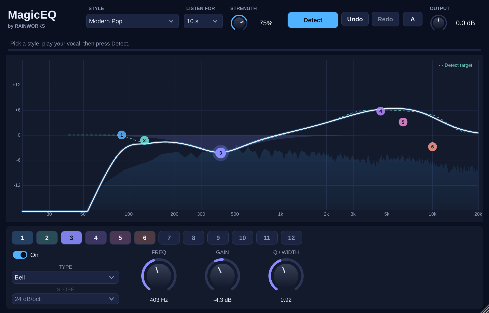

# MagicEQ by RainWorks

A vocal EQ that listens to your voice and tunes itself toward the sound of the genre you pick.



**Status: stage 1 prototype.** The EQ, spectrum analyzer and Detect work. The compressor, limiter
and a fuller preset browser come next (see [Roadmap](#roadmap)). The style curves are first-draft
guesses waiting for a human ear: see [docs/STYLE_CURVES.md](docs/STYLE_CURVES.md).

## What it does

- **Detect.** Pick a style, play your vocal, press **Detect**. MagicEQ listens to 10, 20 or 30 seconds
  of *singing* (silence and gaps between phrases don't count), compares your vocal's tone with the
  style's target curve, then glides the EQ bands into place. One Undo puts everything back.
- **21 styles** across Pop, Hip-Hop, R&B, Rock, Country, Gospel, World, Electronic and Spoken word.
- **Strength** sets how far Detect moves toward the target (75% by default, for fine-tuning rather than
  an overhaul).
- **12 fully adjustable bands**: Bell, Low Shelf, High Shelf, Low Cut, High Cut (12 to 48 dB/oct) and
  Notch, each with frequency, gain and Q.
- **Live spectrum analyzer** behind the EQ curve, plus a dashed line showing what Detect was aiming for.
- **Undo / Redo** (Cmd/Ctrl+Z), **A/B compare**, output gain.
- **Zero latency**, so it is safe to use while tracking.

### Using the graph

| Do this | To |
|---|---|
| Drag a numbered dot | Move a band's frequency and gain |
| Scroll on a dot | Make it wider or narrower (Q) |
| Double-click empty space | Add a band there |
| Double-click a dot | Switch that band off |
| Right-click a dot | Change its type or remove it |

## Getting a build to try

### Easiest: download one (no tools needed)

Every pull request and every change to `main` builds MagicEQ for Mac and Windows automatically.

1. Open the repository's **Actions** tab on GitHub and click the latest green **Build** run.
2. Scroll to **Artifacts** and download **MagicEQ-mac** or **MagicEQ-windows**.
3. Unzip it and follow the `INSTALL-mac.txt` or `INSTALL-windows.txt` inside.

### Build it yourself

You need **CMake 3.22+** and a C++ compiler. The first build downloads JUCE (the audio-plugin
framework) automatically and takes several minutes. Later builds are much faster.

**Mac** (needs Xcode from the App Store, then `xcode-select --install` and `brew install cmake`):

```bash
git clone https://github.com/dfato/magiceq.git
cd magiceq
cmake -S . -B build -DCMAKE_BUILD_TYPE=Release
cmake --build build --config Release --parallel
```

On a Mac the build copies `MagicEQ.component` (AU) and `MagicEQ.vst3` into
`~/Library/Audio/Plug-Ins/` for you, so just restart your DAW.

**Windows** (needs [Visual Studio 2022 Community](https://visualstudio.microsoft.com/vs/community/)
with "Desktop development with C++", and [CMake](https://cmake.org/download/)):

```bat
git clone https://github.com/dfato/magiceq.git
cd magiceq
cmake -S . -B build -G "Visual Studio 17 2022" -A x64
cmake --build build --config Release --parallel
```

Then copy `build\MagicEQ_artefacts\Release\VST3\MagicEQ.vst3` into
`C:\Program Files\Common Files\VST3\`. (Or run the commands from an administrator terminal with
`-DMAGICEQ_COPY_AFTER_BUILD=ON` added to the first `cmake` line and it is copied for you.)

**Run the tests** (checks the filter maths and Detect without a DAW):

```bash
ctest --test-dir build -C Release --output-on-failure
```

## How Detect works

1. **Listen.** While Detect is on, the plugin copies the incoming (pre-EQ) vocal to a background
   analyser. It takes overlapping 4096-point FFTs and averages them, skipping any frame quieter than
   -50 dBFS or more than 25 dB below the loudest frame so far, so breaths and silence don't skew it.
2. **Compare.** The average spectrum is measured on a 1/6-octave grid from 40 Hz to 16 kHz, lined up
   in level with the style's target between 200 Hz and 4 kHz, and subtracted from it.
3. **Decide.** The difference is scaled by Strength, limited to the style's maximum boost and cut,
   and smoothed so it describes broad tonal moves rather than every wiggle.
4. **Fit bands.** A low cut goes in first at the style's frequency. Then MagicEQ repeatedly places a
   bell (or a high shelf above 8 kHz) on the largest remaining difference, sized to its width, and
   finally re-balances all the gains together. Up to 7 tone bands are used, leaving 4 free for you.
5. **Glide.** The bands animate into place over about a second, as a single Undo step.

The code for this lives in `Source/core/` and has no plugin or UI dependencies, so it is tested
directly by `Tests/TestMain.cpp`.

## Project layout

```
Source/
  core/             Pure DSP and Detect logic (tested on its own)
    Biquad.*          Filter designs (RBJ cookbook + Butterworth cascades)
    StyleLibrary.*    The 21 style target curves  <- the guesses to tune
    SpectrumAccumulator.*  Long-term average spectrum with a level gate
    MatchFitter.*     Turns "your vocal vs. the target" into EQ bands
  dsp/EqEngine.h    The real-time 12-band EQ with click-free parameter glides
  Parameters.h      Every automatable parameter
  PluginProcessor.* Audio processing, Detect state machine, A/B, saving
  PluginEditor.*    Main window
  ui/               Look and feel, EQ graph, band controls
Tests/              Automated tests
Tools/Snapshot.cpp  Renders docs/screenshot.png (developer tool)
docs/               Style curve review, install notes, screenshot
```

## Roadmap

- **Stage 2:** compressor (threshold, ratio, attack, release, knee, makeup, gain-reduction meter) that
  Detect also sets, using the per-style compressor character already stored in each style.
- **Stage 3:** limiter with ceiling, release and true-peak mode, placed last in the chain; input and
  output meters.
- **Stage 4:** preset browser (save your own, favourites), per-style descriptions in the UI, and tuning
  the style curves from real reference vocals.
- **Release prep:** code-signing and notarization (Mac), signed installer (Windows), AAX for Pro Tools
  (needs an Avid developer account).

## Licensing note

MagicEQ is built on [JUCE](https://juce.com). JUCE 8 is free to use for commercial products while
your revenue is under its limit; beyond that a paid JUCE licence is needed. Check
[juce.com/get-juce](https://juce.com/get-juce) before selling.
